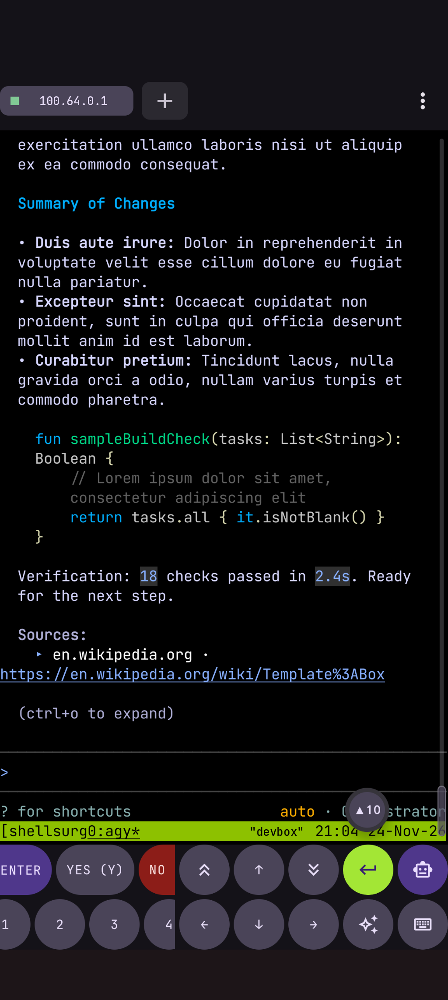
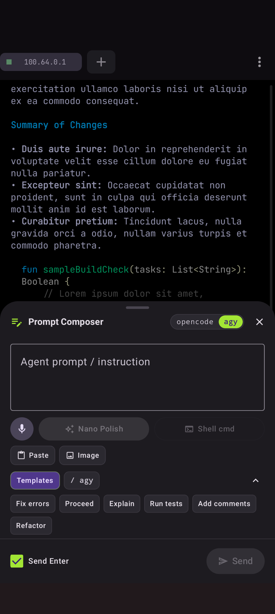
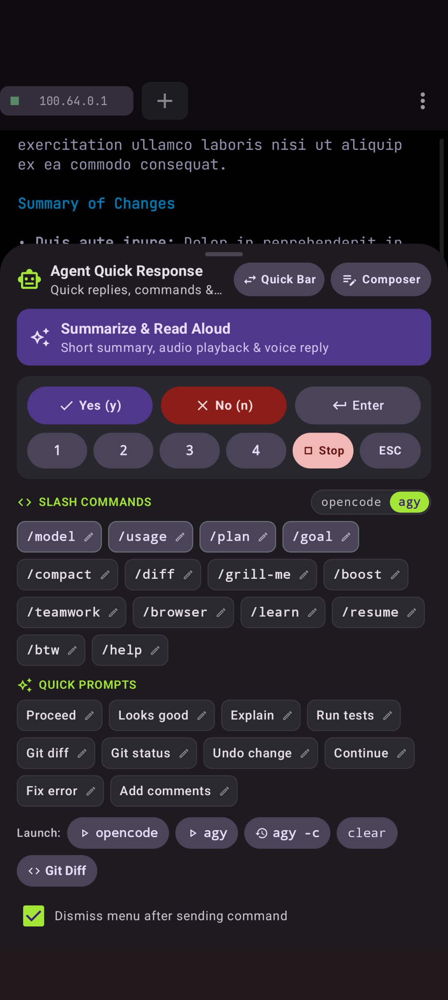
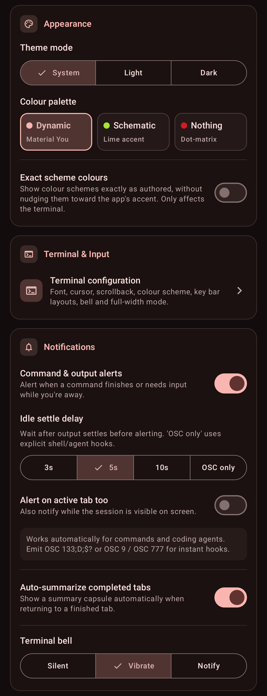
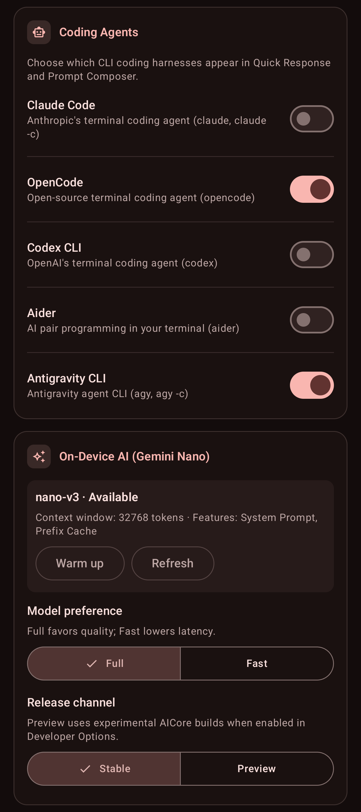

# ShellSurge

<p align="center">
  <b>An Android SSH and terminal client built on <a href="https://github.com/LordOfPolls/Shellwave">Shellwave</a> for remote development and agentic coding workflows.</b>
  <br>
  Adds full Android keyboard input (swipe typing, autocorrect, and voice-to-text), first-class CLI coding harness support, interactive approval/completion notifications, embedded Tailscale (<code>tsnet</code>), mobile Git diff &amp; SFTP tools, unified <code>tmux</code> scroll navigation, and optional on-device Gemini Nano utilities.
  <br><br>
  Requires Android 12 (API 31) or later. GPLv3.
</p>

<p align="center">
  <a href="https://github.com/oreillymonitor/Shellsurge/releases">
    
  </a>
  <a href="https://github.com/oreillymonitor/Shellsurge/actions/workflows/ci.yml">
    
  </a>
  
  <a href="LICENSE">
    
  </a>
</p>

## Screenshots

<p align="center">
  
  
  
</p>
<p align="center">
  
  
</p>

---

## Built on Shellwave

ShellSurge is an independent fork of **[Shellwave](https://github.com/LordOfPolls/Shellwave)** by **LordOfPolls**. The core SSH transport, hardware-backed Android Keystore credential vault, strict host key verification, `tmux` session resilience, port forwarding, script automation, and terminal renderer all come from upstream Shellwave.

**If you find ShellSurge useful, please support the original Shellwave project financially:**

- **[GitHub Sponsors — LordOfPolls](https://github.com/sponsors/LordOfPolls)**
- **[Shellwave on Google Play](https://play.google.com/store/apps/details?id=io.github.lordofpolls.shellwave)** (includes an optional one-time supporter tip in Settings)
- **[Shellwave on F-Droid](https://f-droid.org/packages/io.github.lordofpolls.shellwave)**
- **[Upstream Repository](https://github.com/LordOfPolls/Shellwave)**

---

## Notable Enhancements in ShellSurge

Many of ShellSurge's additions are purpose-built for supervising and driving terminal-based **agentic coding workflows** from a phone without fighting small-screen input, dropped connections, or interactive TUI prompts.

### Full Android Keyboard Support (Swipe, Autocorrect & Voice-to-Text)
The original motivation for this fork: most Android terminal emulators lock the soft keyboard into password/no-suggestions mode, which breaks modern phone typing when writing long prompts or natural-language instructions.
- **Native IME Typing in the Terminal:** Full Android keyboard support enabled by default directly inside the terminal—including **swipe/glide typing**, **autocorrect**, **predictive text suggestions**, and **native keyboard voice-to-text** (e.g., Gboard voice typing).
- **Instant Toggle Back to Raw Mode:** Toggle **Settings → Terminal configuration → Keyboard suggestions & voice typing** off at any time if you prefer classic password-mode terminal input without IME suggestions.

### Agentic Coding Harness Support
Enable only the CLI harnesses you actually use in **Settings → Coding Agents** to populate launch/resume buttons, tailored slash commands, and voice macros in both the **Quick Response** sheet and the **Prompt Composer**:
- **Claude Code:** Launch or resume (`claude`, `claude -c`), plus slash shortcuts including `/compact`, `/model`, `/cost`, `/plan`, `/review`, `/resume`, `/mcp`, and `/clear`.
- **OpenCode:** Launch (`opencode`), plus slash shortcuts including `/models`, `/compact`, `/sessions`, `/new`, `/undo`, `/redo`, `/mcps`, and `/review`.
- **Codex CLI:** Launch (`codex`), plus slash shortcuts including `/model`, `/approvals`, `/diff`, `/review`, `/compact`, `/new`, and `/mcp`.
- **Aider:** Launch (`aider`), plus slash shortcuts including `/add`, `/drop`, `/diff`, `/undo`, `/architect`, `/ask`, `/code`, `/test`, and `/model`.
- **Antigravity CLI:** Launch or resume (`agy`, `agy -c`), plus slash shortcuts including `/model`, `/usage`, `/plan`, `/goal`, `/grill-me`, `/boost`, `/teamwork`, `/browser`, `/learn`, and `/btw`.
- **Per-Host Directory & Auto-Launch:** Configure a startup working directory (`cd`) and an optional launch/resume harness command (or custom command) per host while safely preserving resilient `tmux` session reattach.
- **Quick Response Sheet & Inline Capsule:** Send 1-tap `y`, `n`, `1`–`4`, `Enter`, `Ctrl+C`, `Esc`, harness slash commands, or quick follow-up directives (`Proceed`, `Run tests`, `Git diff`, `Explain`), plus an automatic inline capsule above the KeyBar when `[y/N]` or numbered approval menus are detected.

### Command & Agent Notifications
- **Background Completion & Approval Alerts:** Get notified when a long-running build, command, or agent turn finishes or stalls waiting for input—driven by configurable idle settle delays and terminal escape hooks (`OSC 133`, `OSC 9`, `OSC 777`).
- **TUI-Aware Prompt Detection:** Strips box borders, input boxes, shortcut footers, and `tmux` status bars (and ignores `tmux` status clock ticks so the idle timer isn't starved) to accurately catch `[y/N]` confirmations, conversational questions, and numbered tool-approval menus (`1. Allow once`, `2. Allow for session`, etc.).
- **Interactive Notification Actions:** Answer directly from the Android notification shade using inline **Yes / No** or numbered option buttons plus direct **Reply** (`RemoteInput`) with raw-mode TUI Enter timing.
- **Tab Status Badges & Auto-Digest:** Track background sessions with live `RUNNING`, `COMPLETED`, and `RESPONSE_NEEDED` tab indicators, plus optional automatic digest summaries when returning to a finished tab.

### Embedded Tailscale (`tsnet`) & Network Mobility
- **No VPN Slot Required:** Runs a userspace Tailscale node (`tailscale-bridge/`) inside the app via a local SOCKS5 tunnel, leaving Android's system VPN slot free.
- **Flexible Sign-In:** Supports interactive browser OAuth login, optional pre-auth keys, and custom Headscale control URLs.
- **MagicDNS & Tailnet Browser:** Resolves MagicDNS FQDNs and short peer hostnames directly through `tsnet` (with peer-directory IP fallback), lists your tailnet peers in a **Tailnet Devices** sheet for quick connect or host import, supports keyless Tailscale SSH (`AuthNone`), and preserves remote target ports in `known_hosts` across restarts.
- **Wi-Fi ↔ 5G Handoff & Diagnostics:** Monitors default network transitions on Android to wake reconnecting sessions immediately, update `netmon` routes, and capture startup/crash diagnostics in **Settings → Tailscale (Embedded)**.

### Mobile Git Diff, SFTP & Terminal File Links
- **Git Diff & Status Sheet:** Inspect repository branch, changed files, and color-coded diff hunks directly over SSH, jump straight into editing modified files, or draft a review note in the composer.
- **Expanded SFTP Browser & Remote Editor:** Move, copy, compress, multi-download, open-with, copy remote paths, jump straight from a folder into a terminal, navigate breadcrumb history, and edit files remotely with syntax highlighting.
- **Image Attachment:** Pick a photo via Android's photo picker to upload it via SFTP (`/tmp/shellsurge-*`) and insert the remote path into the prompt composer.
- **Tappable Terminal Paths:** Tap compiler or stacktrace file references (`path/to/File.kt:142`) to edit remotely, download, copy, or send into the composer.

### Prompt Composer, Voice Dictation & Optional Gemini Nano Utilities
- **Full-Width Prompt Composer Sheet:** Pinned Send/Enter footer above the soft keyboard, larger multi-line editor, clipboard paste, image attach, Undo transform restore, and wrapping `Templates` / CLI slash-command tabs without horizontal scrolling.
- **Voice Input & Spoken Macros:** Android speech dictation with agent-aware macros that expand spoken phrases like `"slash plan"`, `"slash model"` (`/model` or `/models`), `"new line"`, and `"bullet point"`.
- **Optional On-Device Text Tools:** Uses Gemini Nano locally via Android AICore on supported devices (such as Pixel 9+) with deterministic offline rule-based fallbacks everywhere else:
  - **Nano Polish:** Cleans up grammar, awkward phrasing, filler words, and multi-step bullet lists while keeping file paths, flags, and commands intact.
  - **Shell cmd:** Converts plain-English requests into a single-line POSIX shell command.
  - **Terminal Digest:** Condenses recent terminal scrollback into a concise summary with error/file extraction, `[y/N]` and numbered option chips, and optional offline Android TTS read-aloud.
- **On-Device AI Settings:** Inspect active AICore model status, token window, and capabilities; trigger **Download / Warm up / Refresh**; and toggle **Full vs Fast**, **Stable vs Preview**, **Thinking mode**, and session pre-warming.

### Tmux Scroll Navigation & Terminal Ergonomics
- **Unified Scroll Engine:** Drag the scrollbar or use `[ ▲10 ]` / `[ ▼10 ]` steppers smoothly across both local scrollback and `tmux` mouse-tracking copy-mode / pagers (`less`, `vim`).
- **1-Tap Return to Prompt:** Tapping `[ N↓ ]` while in `tmux` copy-mode sends `q` and returns directly to the live prompt.
- **KeyBar & Input Polish:** Uniform 48dp touch targets, flush soft-keyboard inset alignment, optional KeyBar auto-hide when a hardware keyboard is attached (with `AltGr` support), Material 3 Settings cards, and a user-initiated GitHub Releases update check.

---

## Core Security & Terminal Foundation (from Shellwave)

- **Resilient Connections:** Automatic reconnection without re-prompting for passwords; optional `tmux`-backed sessions reattach with scrollback intact.
- **Hardware-Backed Keystore:** Saved passwords and private keys encrypted with Android Keystore, with optional per-credential biometric unlock.
- **Strict Host Key Verification:** Fingerprints shown on first connect; changed keys block the connection with no blind accept-all fallback, and background script runs never auto-trust new keys.
- **Key Enrolment:** Generate keys on-device and install them directly into the host's `authorized_keys`.
- **Port Forwarding & Chaining:** Local and remote port forwarding, loopback SOCKS5 proxy, `ProxyJump` chaining, SSH agent forwarding, and `~/.ssh/config` import.
- **Scripts & Automation:** Run saved scripts from the app, widgets, app shortcuts, Quick Settings tiles, or external automation intents.
- **Terminal Engine:** Vendored `termux-app` terminal emulator supporting 256-colour and 24-bit truecolour output, wide characters, and alternate screens.
- **Zero Developer Telemetry:** No analytics, no crash-reporting SDKs, and no developer backend servers. See [PRIVACY.md](PRIVACY.md) for full details.

---

## Installation

- **Releases:** Download the latest signed APK from [GitHub Releases](https://github.com/oreillymonitor/Shellsurge/releases).
- **Package ID:** `io.github.oreillymonitor.shellsurge` (installs side-by-side with upstream Shellwave without conflict).

---

## Building

CI builds the embedded Tailscale AAR (`tailscale-bridge/`) with Go + `gomobile` and compiles the Android app with Gradle:

```bash
# 1. Build the embedded Tailscale bridge AAR (requires Go + Android NDK + gomobile)
(cd tailscale-bridge && gomobile bind -v -target=android/arm64,android/amd64 -androidapi 31 \
  -javapkg=io.github.lordofpolls.shellwave.tailscale -ldflags="-s -w" -o ../app/libs/tailscale-bridge.aar .)

# 2. Build the Android APK
./gradlew assembleFossRelease   # Signed when SHELLWAVE_RELEASE_* env vars are set
./gradlew assembleFossDebug     # Debug APK
```

To run invariant checks, unit tests, and lint:

```bash
./tools/check-invariants.sh
./gradlew testFossDebugUnitTest
./gradlew lintFossDebug
```

---

## Licence & Attribution

GPLv3 — see [LICENSE](LICENSE).

- Forked from [Shellwave](https://github.com/LordOfPolls/Shellwave) (GPLv3) by [LordOfPolls](https://github.com/sponsors/LordOfPolls).
- Terminal core vendored from [termux-app](https://github.com/termux/termux-app) under GPLv3.
- Third-party attribution and library notices live in [NOTICE](NOTICE).
